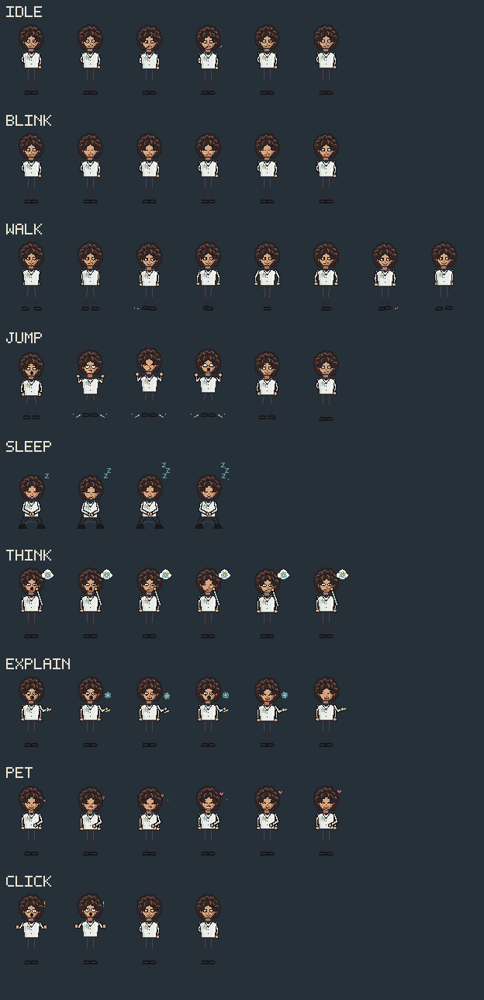

# 费曼桌面宠物

一个面向 Windows 的复古像素风理查德·费曼桌宠。程序使用 WPF 构建无边框、逐像素透明的悬浮窗口，并配有独立动画帧、交互菜单和系统托盘控制。



> 本项目是非官方、个人学习性质的同人作品，与 Richard Feynman 本人及相关机构无关联。角色素材依据用户提供的设计参考重新绘制，没有把设计总览图直接作为运行素材。

## 功能

- 逐像素透明、无边框、可置顶、启动时不抢占键盘焦点的 WPF 悬浮窗口。
- 透明像素区域支持鼠标穿透，角色像素正常响应点击和拖拽。
- 默认尺寸为 64 × 96 像素，并支持 48 × 72、96 × 144 两档切换。
- 拖拽位置、显示尺寸、置顶和自动漫步开关可在重启后恢复。
- 系统托盘支持显示、隐藏、尺寸、置顶和退出。
- 右键菜单可切换全部动作、隐藏或退出。
- 动画帧预加载，运行时直接切换图片，避免状态切换闪烁。
- 隐藏到托盘时停止动画和自动行为计时器，降低不必要的 CPU 占用。

### 动画与互动

| 状态 | 触发方式 | 说明 |
| --- | --- | --- |
| 待机 | 默认 | 呼吸、轻微眼神和发型变化 |
| 眨眼 | 自动/菜单 | 6 帧眨眼动画 |
| 行走 | 自动/菜单 | 8 帧行走，窗口可水平移动并自动翻转朝向 |
| 跳跃 | 菜单 | 蹲下、起跳、腾空和落地 |
| 睡觉 | 菜单 | 闭眼、呼吸和 Z 字效果 |
| 思考 | 菜单 | 手托下巴与原子思考气泡 |
| 讲解物理 | 菜单/双击 | 指向手势与物理气泡文字 |
| 摸头回应 | 点击头部 | 闭眼、微笑和爱心 |
| 点击回应 | 点击身体 | 惊讶、抬手和气泡反馈 |

## 环境要求

- Windows 10 或 Windows 11
- .NET Framework 4.8（Windows 10/11 通常已内置）
- Windows PowerShell 5.1
- Python 3.9 或更高版本：仅在重新生成素材或运行全部测试时需要

运行时不需要 Python，也不依赖 NuGet、npm 或任何第三方服务。

## 快速开始

在项目根目录打开 PowerShell：

```powershell
powershell -ExecutionPolicy Bypass -File .\build.ps1
powershell -ExecutionPolicy Bypass -File .\run.ps1
```

构建产物位于：

```text
bin/FeynmanPet.exe
```

也可以先构建，再直接双击上述可执行文件。`bin/`、`logs/` 和用户设置文件均不会提交到 Git。

## 操作说明

- 左键拖动角色：移动桌宠，松开后保存位置。
- 单击头部：摸头回应。
- 单击身体：点击回应。
- 双击角色：开始讲解物理。
- 右键角色：动作、尺寸、置顶、自动漫步、隐藏和退出菜单。
- 双击托盘图标：恢复桌宠。
- 右键托盘图标：显示/隐藏、调整设置或退出。

可通过命令行指定启动状态和尺寸，便于测试：

```powershell
.\bin\FeynmanPet.exe --state=think --size=96
.\bin\FeynmanPet.exe --size=48 --no-save
```

支持的状态名为：`idle`、`blink`、`walk`、`jump`、`sleep`、`think`、`explain`、`pet`、`click`。

## 开发与构建

### 构建

```powershell
powershell -ExecutionPolicy Bypass -File .\build.ps1
```

构建脚本会：

1. 检查动画素材是否存在。
2. 查找系统自带的 .NET Framework WPF 程序集。
3. 使用 `csc.exe` 编译 `src/FeynmanPet.cs`。
4. 将带图标的可执行文件输出到 `bin/FeynmanPet.exe`。

### 测试

```powershell
powershell -ExecutionPolicy Bypass -File .\tests\test.ps1
```

测试内容包括：

- 156 张 PNG 的尺寸、透明通道和状态覆盖。
- 9 种动画状态机切换。
- 三档窗口实际像素尺寸。
- 无边框、置顶、分层透明和不抢焦点窗口样式。
- 透明像素鼠标穿透与角色点击。
- 右键菜单、尺寸和位置记忆。

### 重新生成动画素材

素材生成器只依赖 Python 标准库：

```powershell
python .\tools\generate_sprites.py
```

它会重新生成三档尺寸的全部透明 PNG、动画清单、预览图和托盘图标。每档尺寸均按目标分辨率原生绘制，不是把大图直接缩小。

## 项目结构

```text
.
├─ assets/
│  └─ feynman/
│     ├─ manifest.json
│     ├─ preview_sheet.png
│     ├─ feynman.ico
│     ├─ 48x72/
│     ├─ 64x96/
│     └─ 96x144/
├─ src/
│  └─ FeynmanPet.cs
├─ tests/
│  ├─ test.ps1
│  └─ test_assets.py
├─ tools/
│  └─ generate_sprites.py
├─ src/archive/                上一版 WPF 源码备份
├─ tools/archive/              上一版素材生成器备份
├─ assets/archive/             上一版 Q 版素材备份
├─ build.ps1
├─ run.ps1
├─ .gitignore
├─ .gitattributes
└─ README.md
```

运行后会创建以下本地文件，它们已被 `.gitignore` 排除：

```text
bin/                       构建产物
logs/runtime.log           运行日志
logs/self-test.txt         最近一次自检结果
data/pet-settings.ini      尺寸、位置和开关设置
```

## 隐私与仓库卫生

- 项目不包含 API Key、密码、Token、OAuth 凭据或私钥。
- 运行日志和位置设置可能包含本机路径或窗口位置，已从版本控制中排除。
- `bin/`、`obj/`、Python 缓存、编辑器缓存和临时文件不会提交。
- 提交仓库前仍建议检查 GitHub Desktop 的变更列表，不要勾选 `data/` 或 `logs/` 中的文件。

## 已知说明

- 可执行文件没有代码签名，Windows 首次运行可能显示 SmartScreen 提示；请确认文件来源后再运行。
- 项目当前未附带开源许可证。如果希望允许他人复制、修改或分发代码与素材，请在公开发布前补充合适的许可证文件。
